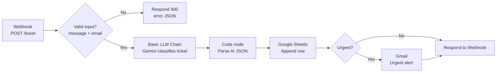

# AI Support Ticket Triage (n8n)

An n8n automation that receives customer support tickets through a webhook, uses Google Gemini to classify each ticket's **category** and **urgency**, logs every ticket to Google Sheets, and sends an email alert for urgent ones. A separate error workflow emails me whenever the main workflow fails.

I built this as a hands-on project to learn n8n: webhooks, REST/JSON handling, OAuth, AI-integrated workflows, input validation, and error handling.

---

## How it works



1. **Webhook** receives a `POST` request with `name`, `email`, and `message`.
2. **IF (validate)** checks that `message` and `email` are not empty. Invalid requests get an HTTP `400` response.
3. **Basic LLM Chain + Google Gemini Chat Model** returns JSON with `category` (billing, technical, sales, other), `urgency` (urgent, normal), and a one-sentence `summary`. Temperature is set to `0` for consistent output.
4. **Code node (Parse AI)** converts the AI's text output into real fields. It strips markdown fences and falls back to safe defaults if the AI returns malformed JSON.
5. **Google Sheets** appends the ticket to a `Ticket Log` sheet.
6. **IF (urgent)** sends an email through **Gmail** only when urgency is `urgent`.
7. **Respond to Webhook** returns a JSON confirmation to the caller.
8. **Error workflow** (separate) uses an **Error Trigger** to email me when any production run fails.

---

## Tech stack

- [n8n](https://n8n.io) (self-hosted, installed with npm)
- Google Gemini (via Google AI Studio API key)
- Google Sheets API and Gmail API (OAuth2)
- JavaScript (n8n Code node)
- Tested on Windows with Node.js 24 (n8n supports Node.js 20.19 to 24.x)

---

## Request and response

**Request**

```json
{
  "name": "Maria Santos",
  "email": "maria@example.com",
  "message": "I was charged twice this month and I need a refund today, my account is about to be suspended!"
}
```

**Success response (200)**

```json
{
  "status": "received",
  "category": "billing",
  "urgency": "urgent"
}
```

**Validation error response (400)**

```json
{
  "status": "error",
  "message": "name, email, and message are required"
}
```

---

## Google Sheet format

Create a sheet named **Ticket Log** with these headers in row 1:

| timestamp | name | email | message | category | urgency | summary |
| --- | --- | --- | --- | --- | --- | --- |

---

## Setup

### 1. Install and run n8n

```bash
node -v                 # must be 20.19 - 24.x
npm install -g n8n
n8n
```

Open `http://localhost:5678` and create your owner account. Keep the terminal open, because the webhook only works while n8n is running.

### 2. Create the Google OAuth credentials

n8n running locally has no one-click Google sign-in, so you create your own OAuth app:

1. In [Google Cloud Console](https://console.cloud.google.com), create a project.
2. Enable the **Google Sheets API**, **Gmail API**, and **Google Drive API** (Drive is needed for n8n's document picker).
3. Configure the **OAuth consent screen** (External) and add your own Gmail address as a **Test user**.
4. Create an **OAuth client ID** (Web application) with this authorized redirect URI:
   ```
   http://localhost:5678/rest/oauth2-credential/callback
   ```
5. In n8n, create **Google Sheets OAuth2 API** and **Gmail OAuth2 API** credentials with the Client ID and Secret, then click **Sign in with Google** for each.

> While the Google app is in Testing mode, tokens expire after about 7 days and need to be reconnected.

### 3. Get a Gemini API key

Create a free key at [Google AI Studio](https://aistudio.google.com) and add it as a **Google Gemini (PaLM) API** credential in n8n.

### 4. Import the workflows

1. In n8n, create a new workflow and choose **Import from file**.
2. Import `workflows/ai-support-ticket-triage.json`.
3. Import `workflows/ticket-triage-error-alert.json` as a second workflow.
4. Open each node that uses a credential (Gemini, Google Sheets, Gmail) and select your own credentials.
5. In the Google Sheets node, select your **Ticket Log** document and sheet.
6. In the Gmail nodes, set the **To** address to your own email.
7. In the main workflow, go to **Settings > Error Workflow** and select **Ticket Triage Error Alert**.
8. Publish both workflows.

---

## Usage

**Test URL** (click **Execute workflow** on the canvas first; it works for one request):

```
POST http://localhost:5678/webhook-test/ticket
```

**Production URL** (workflow must be published and n8n running):

```
POST http://localhost:5678/webhook/ticket
```

**PowerShell**

```powershell
Invoke-RestMethod -Method Post -Uri "http://localhost:5678/webhook/ticket" `
  -ContentType "application/json" `
  -Body '{"name":"Maria Santos","email":"maria@example.com","message":"I was charged twice and need a refund today!"}'
```

**curl (macOS / Linux / Git Bash)**

```bash
curl -X POST http://localhost:5678/webhook/ticket \
  -H "Content-Type: application/json" \
  -d '{"name":"Maria Santos","email":"maria@example.com","message":"I was charged twice and need a refund today!"}'
```

---

## Test cases

| Scenario | Example message | Expected result |
| --- | --- | --- |
| Urgent billing | "I was charged twice... my account is about to be suspended!" | Row logged, urgent email sent, `urgency: urgent` |
| Normal technical | "How do I change my profile picture?" | Row logged, no email, `urgency: normal` |
| Sales question | "Do you offer annual plans?" | Row logged, no email |
| Empty message | `""` | HTTP 400, nothing logged |
| Broken AI credential | any | Workflow fails, error alert email sent |

---

## Error handling

- **Input validation:** missing `message` or `email` returns a clear 400 response before any AI call is made.
- **Malformed AI output:** the Code node wraps `JSON.parse` in a `try/catch` and falls back to `category: other`, `urgency: normal`, so a bad AI response doesn't break logging.
- **Failure alerts:** a separate workflow with an Error Trigger emails the workflow name, the failing node, and the error message.

---

## What I learned

- Webhook payloads arrive under `body`, so fields are referenced as `$json.body.message`.
- The difference between test and production webhook URLs, and between running a single node and running the whole workflow.
- How to reference data from earlier nodes with `$('Node Name').first().json`.
- Setting up Google OAuth credentials by hand (consent screen, test users, redirect URIs, enabling APIs).
- Getting reliable structured output from an LLM and defending against malformed responses.
- Building a dedicated error workflow for production monitoring.

---

## Possible improvements

- Draft an AI-generated reply email for each ticket
- Route categories to different team inboxes with a Switch node
- Post urgent tickets to Slack or Telegram
- Add webhook authentication (header or token)
- Deduplicate tickets by email and message
- Move from a local setup to Docker or a hosted n8n instance with a stable public URL

---

## Project structure

```
.
├── README.md
├── workflows/
│   ├── ai-support-ticket-triage.json
│   └── ticket-triage-error-alert.json
└── screenshots/
    ├── workflow-canvas.png
    ├── google-sheet-log.png
    └── urgent-email.png
```

## Security note

Exported workflow files reference credentials by name and ID only. Never commit API keys, OAuth client secrets, or tokens. Use your own credentials after importing.
